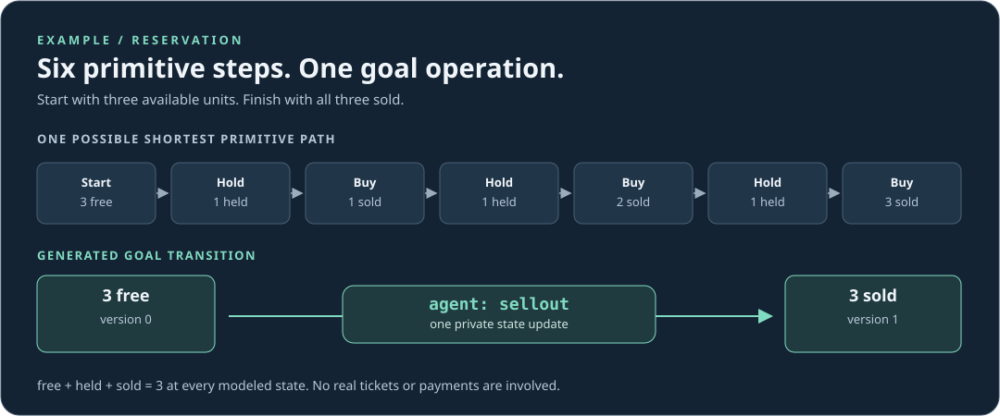
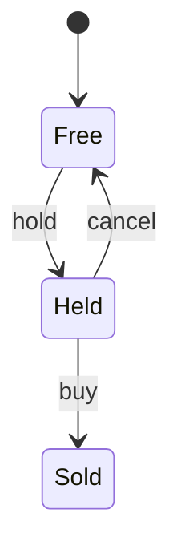

# Rho Foundry

**Write the rules. Let the contract take shape.**

[](https://github.com/rhovision-org/rho-foundry/actions/workflows/ci.yml) [](LICENSE)

Created by **[AixAria](https://github.com/aixaria0)** ([@aixaria0](https://github.com/aixaria0)).

Suppose you are building a booking system with only three seats. A seat can be free, held or sold. The system must not sell more seats than it has. Nobody should accidentally create a fourth seat.

You can explain the rules in a minute. Writing and checking all of the corresponding contract branches takes longer.

I wanted to make that distance smaller. Rho Foundry turns a finite description of resources, roles, actions and rules into executable Rholang.


[Still image](docs/motion/overview.png) · [How the animation was made](docs/motion/README.md)

## Three seats are still three seats

Here's the idea in plain language: write down how many seats exist, who is allowed to reserve or buy them, and the rule that the sum of free, held and sold seats must always be three.

Foundry explores the reachable combinations. If an enabled action can violate that rule, the compiler rejects the specification. If the rules admit a safe authorized path to a goal, it generates the corresponding operation.



The example agent can use a generated `sellout` operation to change the three internal units in one atomic update. It already has authority to hold and buy them. The compiler does not obtain payment or consent, sell real tickets or acquire extra permissions.

## Your first contract

Install Git and Python 3.11 or newer. There are no third-party Python dependencies.

```sh
git clone https://github.com/rhovision-org/rho-foundry.git
cd rho-foundry
python3 -m foundry examples/reservation.json --out generated
```

You'll get `contract.rho` and `machine.json`. One is the generated Rholang factory; the other is the corresponding state model, including the paths Foundry found.

Now open [reservation.json](examples/reservation.json). Change the three resource capacities, the initial free count, the conservation total and the goal from three to five. Save a copy and compile it into another directory. You have a new finite contract without rewriting the compiler.

The [full tutorial](docs/GUIDE.md) walks through that edit, inspecting a generated plan and creating a complete runnable Rholang demonstration.

## What is the compiler doing?

The input specifies bounded integer resources, linear guards and invariants, actions and role-scoped goals. Foundry enumerates reachable states, checks declared invariants, finds shortest permitted goal paths and generates a factory with private state and revision checks.



The diagram shows one unit's movement. The compiler tracks all three units together and enforces the supplied resource bounds. Concurrent operations compete for one private state token, so stale requests cannot both change the same version.

This is contract generation for finite internal resource logic, not a compiler for arbitrary Rholang or a system that handles external payments and identity automatically. Forge is a related alternative if consume/produce notation and conservation rules are a better fit for the workflow.

[Specification reference](docs/SPECIFICATION.md) · [Complete tutorial and API](docs/GUIDE.md) · [CI](https://github.com/rhovision-org/rho-foundry/actions)

The [recorded native runtime run](https://github.com/rhovision-org/rho-foundry/actions/runs/45787135128) passed 271 exploratory scenarios on the pinned Rholo binary. Compiler tests also compare 150 randomized resource models against a reference search. These are fixture results, not a universal proof of production correctness.

## The Rho family

- **[Rho Observer](https://github.com/rhovision-org/rho-observer)** — See what the network actually reports.
- **[Rho Weave](https://github.com/rhovision-org/rho-weave)** — Find a safe next move when information is missing.
- **[Rho Forge](https://github.com/rhovision-org/rho-forge)** — Turn resource flows into executable actors.

Foundry and Forge are alternatives for generating finite contract logic. Weave helps design decisions around uncertain external conditions, while Observer reports network evidence. Foundry needs neither at compile time.

They share a direction, not an automatic integration. [See how the pieces could fit together](docs/ECOSYSTEM.md).

## License

[Apache License 2.0](LICENSE). External software remains under its own license.
