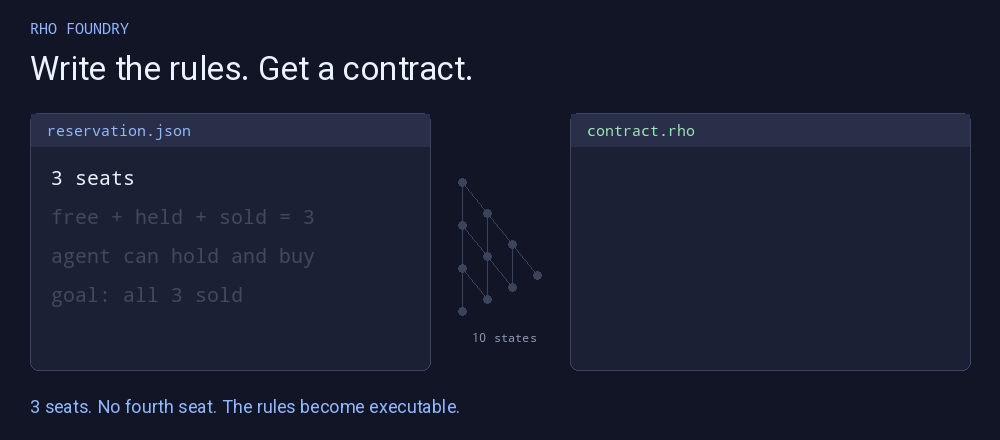
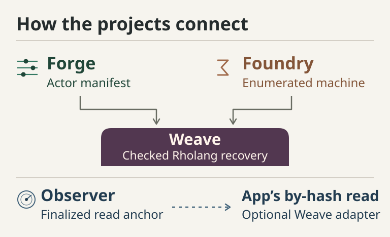

# Rho Foundry

A booking service has a million seats and a quarter-million hold limit. The rules fit in a few lines. A table of every reachable inventory would be a different story.

I built Foundry to turn rules about quantities, permissions and limits into contracts. Its symbolic compiler can turn the million-seat quota into one authorized Rholang update.

Created by [AixAria](https://github.com/aixaria0).



[Static storyboard](docs/motion/overview.png) · [Text walkthrough](docs/motion/README.md)

## Put the quota into a contract

With Git and Python 3.11+, compile the included rules.

```sh
git clone https://github.com/rhovision-org/rho-foundry.git
cd rho-foundry
python3 -m foundry examples/hold-quota.json --symbolic --out quota
```

The input starts with one million free seats and zero holds or issuances. It says that the total stays fixed, holds stay below or at the quota, and only the manager may call the `fill_quota` goal. The command writes `quota/contract.rho`, an executable factory, and `quota/machine.json`, with the ordered counters, role list and invariant-check results.

The manager call filled 250,000 holds in the native Rholo test. The single successful call changed the revision from 0 to 1 and returned counts of 750,000 free, 250,000 held and zero issued. A competing call at revision 0 returned `STALE`. An application calls the factory, keeps its role capabilities scoped and reads the ordered counter vector from the reply. [Quota specification](examples/hold-quota.json) · [Native test and calling convention](docs/SYMBOLIC.md)

Try a lower quota in a copy of the example. Set the hold invariant and `fill_quota` target to 100,000 and set the reserve guard's threshold to 99,999. Recompile into a fresh directory. The million-seat inventory and its conservation rule can stay as they are.

## Choose how the contract is compiled

The enumerating compiler explores reachable states and finds authorized paths through a sequence of actions. The three-seat reservation reaches its `sellout` goal through holds and purchases, then exposes that path as one operation. The generated machine lists the states and the rules.

```sh
python3 -m foundry examples/reservation.json --out reservation
```

The symbolic compiler keeps counters, emits arithmetic guards and checks that each enabled move preserves the stated invariants. A supported symbolic goal repeats one authorized action and uses a unit-rate equality to determine the repetition count. Foundry checks the endpoint conditions for that update. Use the enumerating backend for finite goals that need several different actions. [Three-seat walkthrough](docs/GUIDE.md) · [Specification reference](docs/SPECIFICATION.md) · [Symbolic proof rules](docs/SYMBOLIC.md#invariant-checks)

### A measured change in compilation

In the 32-seat fixture with an eight-seat hold limit, the enumerating compiler stores 261 reachable states. Both columns below use the same rules.

| 32-seat quota fixture | Enumerated, one pass | Symbolic |
| --- | ---: | ---: |
| Stored states | 261 | 0 |
| Generated Rholang bytes | 111,472 | 3,427 |
| Median compile time | 6.786 ms | 0.171 ms |
| Peak traced Python allocation | 936,495 bytes | 16,467 bytes |

The medians come from 15 compiler samples per backend on a GitHub runner. Reusing a single enumeration for source and manifest reduced the enumerated median from 11.964 to 6.786 ms in the same run. The million-seat input exceeds the enumerating compiler's state budget. The symbolic output for that case is 3,522 bytes. Native Rholo checks verify the quota behavior and compare the backends across a smaller fixture. [Benchmark and native results](https://github.com/rhovision-org/rho-foundry/actions/runs/45806395234) · [Reproduction commands](docs/SYMBOLIC.md#try-the-large-quota)

## Put the right contract behind the app



When the important thing is how inventory moves through independent groups, [Forge](https://github.com/rhovision-org/rho-forge) can give each group its own revision. Use Foundry when the contract is best described by arithmetic conditions on counters.

With Foundry's enumerated machine, [Weave](https://github.com/rhovision-org/rho-weave) can build a recovery controller from the authorized rules. The native demo also runs the controller on the three-seat Foundry contract. Symbolic output runs directly as a contract with a counter vector and has no enumerated transition table for Weave to import. [Recovery demo](https://github.com/rhovision-org/rho-weave/blob/main/docs/RECOVERY.md)

An application that needs a finalized network read can ask [Observer](https://github.com/rhovision-org/rho-observer) which block its configured sources support. That read is separate from the role and revision checks inside the quota contract. [Interface map](docs/ECOSYSTEM.md)

[Repository structure and contributions](docs/DEVELOPMENT.md) · [CI](https://github.com/rhovision-org/rho-foundry/actions)

## License

[Apache License 2.0](LICENSE). External software remains under its own license.
