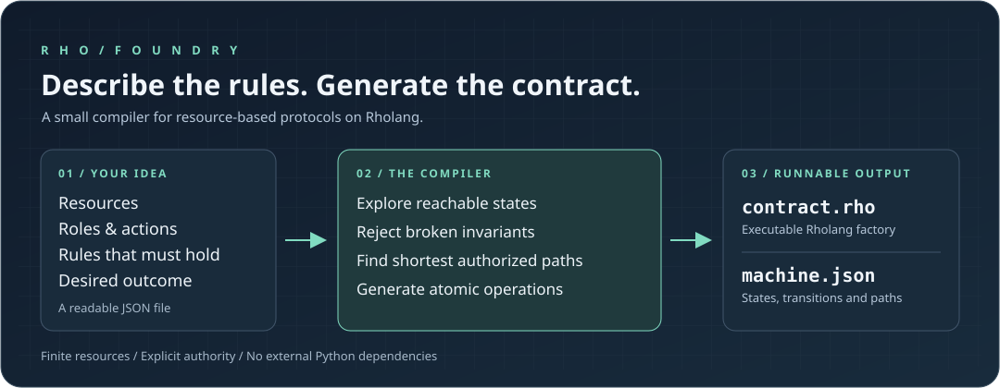
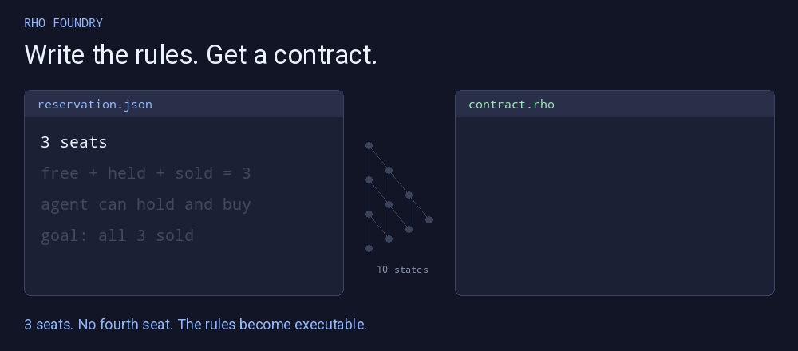
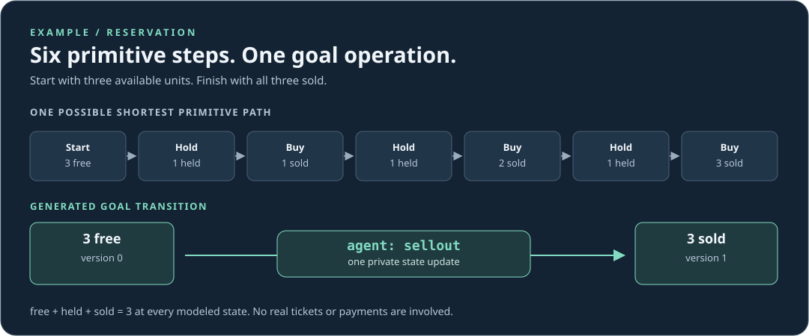
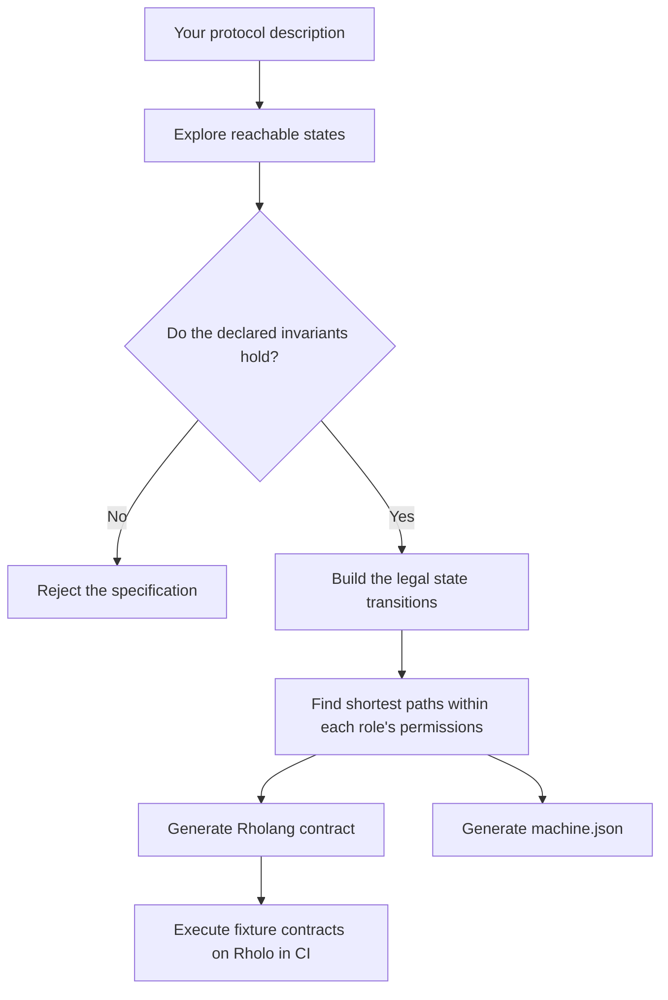
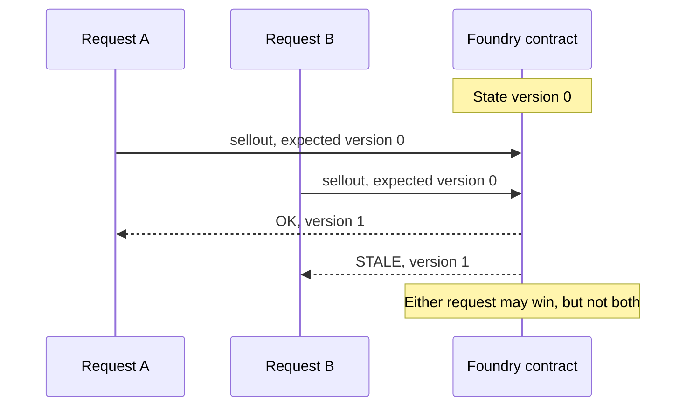
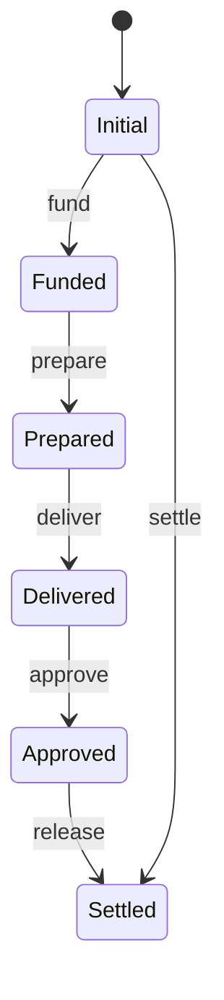
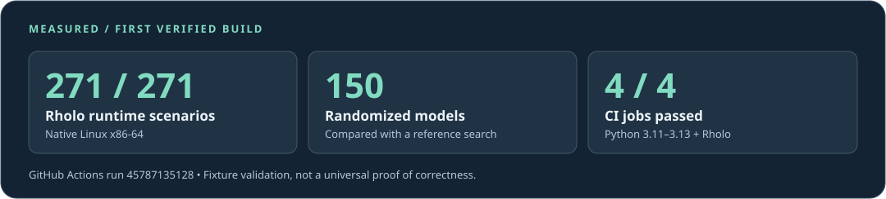

# Rho Foundry

[](https://github.com/rhovision-org/rho-foundry/actions/workflows/ci.yml)
[](https://www.python.org/)
[](../LICENSE)





[Static version](../docs/motion/overview.png) · [Motion source](../docs/motion/README.md)

## Why I built this

When we build systems, we spend a lot of time translating the same idea into different things: a specification, a state machine, permission checks, contract code and tests. Every translation is another place where we can misunderstand the original idea.

I wanted to see how much of that work a machine could do for us.

Rho Foundry starts with a simple description of a protocol and generates an executable Rholang contract from it. The idea is to make it easier to build on RhoVision, especially for people who understand the problem they want to solve but are still learning Rholang.

A developer should be able to concentrate on how a system ought to behave instead of writing all the state-management logic again for every new project.

## What does that mean in practice?

Imagine you have three seats available for an event. A seat can be free, reserved or sold. You don't want to sell a seat twice, and you don't want the system to accidentally create a fourth seat.

Those are the rules of your system. You write them down in a small JSON file:

| Question | Example |
| --- | --- |
| What are we managing? | Three seats |
| Who can act? | An agent and a customer |
| What can they do? | Reserve, cancel or buy |
| What must never change? | Free + reserved + sold = 3 |
| What outcome do we want? | Sell all three seats |

Foundry explores the states that can actually be reached under those rules. It builds the allowed transitions, checks the constraints and generates the contract.

If the description contains a reachable violation of an invariant (a rule that must always hold), compilation fails. It doesn't quietly ignore the bad rule and carry on.



In this example the agent already has permission to reserve and buy seats. Foundry discovers a six-step path to the goal, then generates a single operation called `sellout`. That operation updates the modeled resources together.

There is no external ticket service, payment provider or automatic consent involved. This is a small accounting example of how a more complicated workflow can be built out of simpler operations.

## What it adds

For each accepted finite specification, Foundry builds the reachable graph instead of requiring a developer to manually enumerate the contract branches. It checks declared invariants, respects allowed roles, and finds goal paths using only authorized primitive actions.

A goal operation is an internal atomic transition from the current resource vector to its synthesized target. It does not execute several external contracts, collect real-world consent or bypass another role's authority.

| Before | With Foundry |
| --- | --- |
| Manually translate guards into contract branches | Generate branches from reviewed predicates |
| Manually map allowed roles | Generate separate role capabilities |
| Reason about legal multi-step paths | Compute shortest authorized paths |
| Maintain state IDs separately | Generate the machine description and contract together |

## How it works



Foundry treats the protocol as a graph. Each node represents a possible combination of resource values; each edge represents an allowed action. For a goal, the compiler searches that graph backwards from states where the goal is satisfied. This finds the shortest permitted path from each reachable starting state.

The generated contract stores the state in a private channel. Each successful operation consumes and replaces the state token, so two requests cannot both update the same version.



Here request A happened to win. The reverse ordering is also valid. A caller that receives `STALE` needs to inspect the current state before deciding what to do next.

## Try it yourself

You only need Python 3.11 or newer and Git. There are no Python packages to install, no API keys and no running node required to generate a contract.

```bash
git clone https://github.com/rhovision-org/rho-foundry.git
cd rho-foundry
python3 -m foundry examples/reservation.json --out generated
```

On Windows, use `py -3` if your Python command is not `python3`.

The output will report 10 reachable states, 18 primitive transitions and 39 generated rules for the reservation example.

```text
generated/
  contract.rho     The generated Rholang factory
  machine.json     The state graph and synthesized operations
```

The output directory must not already exist. Choose a new name for each compilation, or move the previous output somewhere else.

Open [examples/reservation.json](../examples/reservation.json) and compare it with the generated files. You can see exactly which part of the specification becomes a contract operation.

### Your first change

Copy the example and change the number of seats from three to five. You can do that in a text editor, or use this small script:

```bash
python3 - <<'PY'
import json
from pathlib import Path

spec = json.loads(Path("examples/reservation.json").read_text())
for resource in spec["resources"].values():
    resource["capacity"] = 5
spec["resources"]["free"]["initial"] = 5
spec["invariants"][0]["rhs"] = 5
spec["goals"][0]["predicates"][0]["rhs"] = 5
Path("five-seats.json").write_text(json.dumps(spec, indent=2))
PY

python3 -m foundry five-seats.json --out generated-five
```

You now have a new contract for five seats without changing the compiler or writing the state-management logic by hand.

### See the generated plan

```bash
python3 - <<'PY'
import json
from pathlib import Path

machine = json.loads(Path("generated/machine.json").read_text())
for rule in machine["rules"]:
    if rule["operation"] == "sellout" and rule["state"] == 0:
        print("Role:", rule["role"])
        print("Path:", " -> ".join(rule["path"]))
        print("Target resources:", dict(zip(
            machine["resources"], machine["states"][rule["target"]]
        )))
PY
```

You should see the agent's six-action plan and a final state with three sold seats, zero free seats and zero held seats.

### Execute a complete Rholang demo

The generated factory is designed to be placed inside a private scope. To produce a complete runnable term, including a caller, use the same small driver that the runtime tests use:

```bash
python3 - <<'PY'
import json
from pathlib import Path
from tools.runtime_check import seq

spec = json.loads(Path("examples/reservation.json").read_text())
source, expected = seq(spec, [
    ("agent", "sellout", 0),
    ("agent", "inspect", 0),
    ("agent", "sellout", 0)
])
Path("reservation-demo.rho").write_text(source)
print("Expected responses:", expected)
PY
```

The resulting `reservation-demo.rho` is a complete Rholang term. On a disposable Rholo devnet that supports exploratory deploy, submit the term through the node's exploratory execution interface. Do not use a production node for the demo.

The first request succeeds, the second reads the state, and the third is rejected because its version is stale. The term sends indexed result tuples to its first private channel, the same output mechanism used by the pinned Rholo runtime tests.

You can also see the actual results from the [successful native runtime CI run](https://github.com/rhovision-org/rho-foundry/actions/runs/45787135128).

## Another example: escrow

The second [example](../examples/escrow.json) uses synthetic balances and three progress flags. It models a path from the buyer's balance to the seller's balance:



The settler role is explicitly authorized to perform all five primitive actions. Foundry can therefore synthesize the full path into a single `settle` operation. If the protocol has already reached an intermediate state, it can synthesize the remaining permitted path from there.

The buyer or seller cannot use that goal unless the specification gives them the required authority. The compiler rejects a goal that attempts to grant a role access to primitive actions it cannot perform.

These flags and balances are internal model values, not evidence of real delivery or approval. A real escrow would need external authentication, consent and asset custody logic.

```bash
python3 -m foundry examples/escrow.json --out generated-escrow
```

## Writing your own protocol

The specification has six parts:

| Field | Meaning |
| --- | --- |
| `name` | A short identifier for the protocol |
| `resources` | Integer values, each with an initial amount and a capacity |
| `roles` | The names of the capabilities to issue |
| `invariants` | Conditions that must hold for every reachable state |
| `actions` | Named changes to resources, with guards and allowed roles |
| `goals` | Desired outcomes and the role and actions allowed to reach them |

A condition is written as a weighted sum of resource values. For example:

```json
{"weights": {"free": 1, "held": 1, "sold": 1}, "op": "eq", "rhs": 3}
```

That means the sum of free, held and sold units must equal three. The compiler supports equality (`eq`), less than or equal (`le`) and greater than or equal (`ge`).

An action that reserves one seat looks like this:

```json
{
  "name": "hold",
  "roles": ["agent", "customer"],
  "guards": [],
  "delta": {"free": -1, "held": 1}
}
```

The action cannot run when there are no free seats because the result would be outside the allowed resource bounds.

The [specification reference](../docs/SPECIFICATION.md) explains the complete input format, error behavior, limits and generated contract interface.

## Using a generated contract in your own application

A factory creates a new private instance and returns separate send-only capabilities for each role in the order given in your specification.

```rho
cap!("operation", expectedVersion, *reply)
```

The reply is a tuple containing a status, a state ID and a version number. State IDs can be decoded using the `states` and `resources` lists in `machine.json`.

| Reply | What happened |
| --- | --- |
| `OK` | The operation succeeded and the version increased |
| `DENIED` | The operation was unknown, not permitted or not enabled |
| `STALE` | The expected version did not match the current one |
| `EXHAUSTED` | The maximum version was reached; no wraparound |
| `STATE` | The current state and version were returned without a change |

Use the operation `inspect` to read the state. All issued roles can inspect it.

A capability is like a key: whoever possesses it can use it. It is the application's responsibility to distribute the capabilities securely. Foundry does not identify people or manage their keys for them.

## What has actually been tested?



The first successful end-to-end CI run used the real Rholo binary on Linux x86-64, not a simulator. The node was standalone, on loopback, with synthetic keys and no peers. Its block height remained unchanged during the tests.

| Example | Reachable states | Primitive transitions | Generated rules |
| --- | ---: | ---: | ---: |
| Escrow | 6 | 5 | 14 |
| Reservation | 10 | 18 | 39 |

The compiler is also tested against a separate forward-search reference algorithm, including 150 randomized reservation specifications. The runtime tests exercise both examples across reachable states, roles and operations, as well as stale requests, concurrent calls and independent instances.

- [Recorded successful run — 271/271 runtime scenarios](https://github.com/rhovision-org/rho-foundry/actions/runs/45787135128)
- [Source revision used for that run](https://github.com/rhovision-org/rho-foundry/commit/d222da77fe4582a56e6d91f52409f3ccf133b222)
- [Current CI status](https://github.com/rhovision-org/rho-foundry/actions)

To run the compiler's tests yourself:

```bash
python3 -m unittest discover -s tests -v
```

These results establish what was tested, not that every possible generated contract is correct in every environment.

## Where this could fit in RhoVision

Foundry is independent of the existing projects. It generates Rholang rather than introducing a new execution environment or requiring changes to Rholo.

I see resource allocation, reservation, controlled internal accounting and finite workflow coordination as useful starting points. The longer-term interest is in giving other developers a smaller set of things they have to implement themselves when building new systems.

At the moment, this is a compiler for finite integer resource models. It does not compile arbitrary Rholang, move external assets, coordinate independent blockchains or manage identities. It uses one private state token per instance; it does not claim parallel scaling across the resources inside that token. The limits are deliberate and documented so developers can decide whether their use case fits.

## Repository map

| Path | Contents |
| --- | --- |
| [foundry/](../foundry/) | Compiler and command-line interface |
| [examples/](../examples/) | The two example protocol descriptions |
| [tests/](../tests/) | Compiler tests and reference search |
| [tools/runtime_check.py](../tools/runtime_check.py) | Real Rholo runtime test driver |
| [docs/](../docs/) | Specification reference and visual explanations |
| [.github/workflows/ci.yml](../.github/workflows/ci.yml) | Compiler and native runtime CI |

## Contributing

If you have a resource-based protocol in mind, try expressing it as a specification first. A small example that exposes a missing capability is especially useful.

For a bug report, include the specification and the output you expected. For a proposed change, a working example and a reproducible test are much more useful than a long description alone.

## The Rho project family

The four projects share an idea: make the parts of engineering that can be expressed precisely easier to inspect, reuse and execute. They are independent tools, not four stages of a mandatory runtime stack.

| Project | Focus | Capability |
| --- | --- | --- |
| [Rho Observer](https://github.com/rhovision-org/rho-observer) | Read-only evidence | Compare configured endpoints and keep missing or conflicting evidence visible. |
| [Rho Weave](https://github.com/rhovision-org/rho-weave) | Decision policies | Synthesize safe finite strategies when observations leave several states possible. |
| [Rho Forge](https://github.com/rhovision-org/rho-forge) | Resource-flow actors | Generate Rholang actors from consumption, production, conservation and role-specific missions. |
| **Rho Foundry (you are here)** | Guarded contracts | Generate Rholang factories from bounded integer resources, guards, invariants and goals. |

### How they relate

Foundry focuses on explicit rules and predicates over integer resources. It can represent guarded transitions and check whether reachable actions preserve declared invariants. Forge approaches a similar contract-generation problem with consumption/production, conservation rules and role-specific marking goals. Choose the model that fits the protocol; there is no required Forge-to-Foundry conversion.

Observer can help a developer understand reported network conditions, and Weave can synthesize a decision policy for a separately authored uncertain protocol. Foundry does not currently integrate these runtime interfaces automatically.

For a concrete example of how a developer could combine the ideas, see [the ecosystem guide](../docs/ECOSYSTEM.md). The examples are architectural illustrations, not claims of an existing integrated deployment.

## License

Rho Foundry is released under the [Apache License 2.0](../LICENSE).

You can use, modify and redistribute the project under the terms of that license, including its notice and attribution requirements. External software used to test Foundry, including the Rholo runtime, remains subject to its own license.
